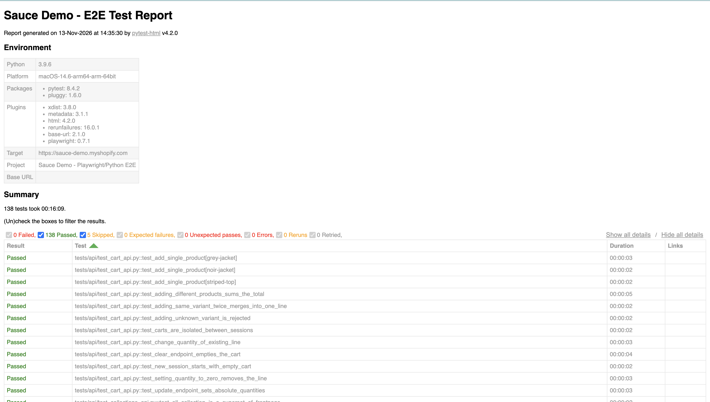

# Sauce Demo – E2E Test Automation Framework


A production-style test automation framework for the Shopify demo storefront
**https://sauce-demo.myshopify.com/**, built with **Playwright, Python and pytest**.
It combines **UI, API, end-to-end and regression** testing in one maintainable codebase and runs in CI on every push.

| | |
|---|---|
| **Total tests** | 143 (UI · API contract · E2E journeys) |
| **Latest full run** | 138 passed · 5 skipped · 0 failed |
| **Smoke suite** | 36 tests, about 2 minutes |
| **Browsers** | Chromium (default), Firefox, WebKit |
| **CI** | GitHub Actions (smoke gate → regression, nightly) · Jenkinsfile included |

> The 5 skips are deliberate: 2 are opt-in tests (real customer registration and valid-customer login) and up to 3 are
> skipped when Shopify's rate limiter blocks a page. See [Handling a rate-limited public site](#handling-a-rate-limited-public-site).

---

## Table of contents
1. [Highlights](#highlights)
2. [What is covered](#what-is-covered)
3. [Architecture](#architecture)
4. [Project structure](#project-structure)
5. [Getting started](#getting-started)
6. [Running the tests](#running-the-tests)
7. [Configuration](#configuration)
8. [Reports and debugging](#reports-and-debugging)
9. [Continuous integration](#continuous-integration)
10. [Handling a rate-limited public site](#handling-a-rate-limited-public-site)
11. [Design decisions](#design-decisions)
12. [Limitations and next steps](#limitations-and-next-steps)
13. [Author](#author)

---

## Highlights
- **Page Object Model.** Every locator lives in `pages/`, so a markup change is fixed in one place and tests read like user stories.
- **Hybrid UI + API testing.** Shopify's Ajax API (`/cart.js`, `/cart/add.js`, …) seeds and verifies cart state. UI tests check one behaviour each instead of re-running the whole purchase flow.
- **API contract tests.** JSON Schema validation (`jsonschema`) for products, collections and cart payloads, plus negative and pagination cases.
- **No hard-coded IDs.** Live variant IDs and prices are resolved once per session (`product_catalog` fixture); expected business data lives in `testdata/products.json`.
- **Layered test selection.** Markers (`smoke ⊂ regression`, plus `ui`, `api`, `e2e`, `functional`, `negative`, `responsive`) let you run exactly the slice you need. Layer markers are applied automatically from the folder.
- **Resilient to a flaky third party.** Retry with exponential back-off on HTTP 429, request pacing, and skip-not-fail when the environment blocks a page.
- **Useful reports.** Self-contained HTML report with failure screenshots, plus Playwright traces and videos on failure.
- **Configurable.** Typed settings loaded from environment variables or a `.env` file; nothing environment-specific is hard-coded.
- **CI-ready.** GitHub Actions workflow with a smoke gate, nightly regression and an on-demand browser matrix.

---

## What is covered

| Area | UI | API | E2E |
|---|:--:|:--:|:--:|
| Home page and featured products | ✔ | ✔ | ✔ |
| Navigation, menu links, 404 handling | ✔ | ✔ | |
| Catalog and collections | ✔ | ✔ | |
| Product detail (title, price, image, description, related products) | ✔ | ✔ | ✔ |
| Search (matches, case-insensitive, no result, empty query) | ✔ | ✔ | ✔ |
| Cart (add, merge, update quantity, remove, clear, persistence, session isolation) | ✔ | ✔ | ✔ |
| Checkout entry | ✔ | | ✔ |
| Login and registration forms (negative cases, opt-in positive cases) | ✔ | | |
| Content pages, footer, social links, payment icons | ✔ | | |
| Responsive layout (375 / 768 / 1440 px) | ✔ | | |
| Broken-link and failing-request checks | ✔ | | |
| HTTPS redirect, robots.txt, sitemap, response-time budget | | ✔ | |

The full scope, strategy, coverage matrix and risks are in [`docs/TEST_PLAN.md`](docs/TEST_PLAN.md).

**E2E journeys**
1. Guest browses → opens a product → adds to cart → verifies cart → reaches checkout
2. Shopper buys several products and the cart total is correct
3. Shopper finds a product through search and buys it
4. Shopper changes a quantity, then removes the item
5. A second browser session sees an empty cart (cart privacy)
6. Empty cart does not start a checkout

---

## Architecture

```
                 ┌─────────────────────────────────────────┐
                 │               tests/                    │
                 │   ui/            api/            e2e/   │
                 └───────┬────────────┬───────────────┬────┘
                         │            │               │
              ┌──────────▼───┐  ┌─────▼─────┐   ┌─────▼─────────────┐
              │   pages/     │  │ clients/  │   │ pages/ + clients/ │
              │ Page Objects │  │ ShopifyApi│   │  (hybrid)         │
              └──────────┬───┘  └─────┬─────┘   └─────┬─────────────┘
                         │            │               │
              ┌──────────▼────────────▼───────────────▼─────┐
              │ conftest.py  (fixtures, hooks, reporting)   │
              │ config/settings.py · testdata/ · utils/     │
              └─────────────────────────────────────────────┘
```

- **`conftest.py`** provides the fixtures (`page`, page objects, `api`, `cart_api`, `product_catalog`), Playwright overrides, automatic layer markers and failure-screenshot embedding.
- **`cart_api`** is bound to the browser context (`page.request`), so UI and API share cookies and therefore the same cart. This is what makes the hybrid tests possible.
- **`api`** is a standalone client; each test gets a fresh cookie jar and an isolated cart.

---

## Project structure

```
sauce-demo-e2e/
├── conftest.py                 # fixtures, hooks, pacing, report enrichment
├── pytest.ini                  # markers, reporting, artifacts, retries
├── requirements.txt
├── .env.example                # all configurable values (placeholders only)
├── config/
│   └── settings.py             # typed, environment-driven configuration
├── pages/                      # Page Objects
│   ├── base_page.py            #   header, footer, product grid, shared helpers
│   ├── home_page.py · catalog_page.py · product_page.py · cart_page.py
│   └── search_page.py · login_page.py · register_page.py · content_pages.py
├── clients/
│   └── shopify_api.py          # API client with 429 retry/back-off
├── testdata/
│   ├── products.json           # expected products and prices
│   └── schemas.py              # JSON Schemas for contract tests
├── utils/
│   └── helpers.py              # money helpers, retry/checkpoint recovery
├── tests/
│   ├── ui/                     # browser-driven page tests
│   ├── api/                    # HTTP-level contract and behaviour tests
│   └── e2e/                    # complete customer journeys
├── docs/
│   └── TEST_PLAN.md            # scope, strategy, coverage matrix, risks
├── .github/workflows/tests.yml # GitHub Actions pipeline
└── Jenkinsfile                 # Jenkins pipeline
```

---

## Getting started

**Prerequisites:** Python 3.9 or newer and Git.

```bash
git clone https://github.com/yplyndon/sauce-demo-e2e.git
cd sauce-demo-e2e

python3 -m venv .venv
source .venv/bin/activate          # Windows: .venv\Scripts\activate

pip install -r requirements.txt
playwright install chromium        # add firefox and webkit for cross-browser runs

cp .env.example .env               # optional; every value has a default
```

In VS Code, open the folder, run **Python: Select Interpreter** and choose the `.venv` interpreter.

---

## Running the tests

```bash
pytest                                  # everything (Chromium, headless)
pytest -m smoke                         # fast critical-path gate
pytest -m regression                    # full regression pack (sequential)

pytest -m ui                            # by layer
pytest -m api
pytest -m e2e

pytest -m "e2e and smoke" --headed      # one journey, visible browser
pytest -m "ui and negative"             # invalid-input scenarios only
pytest -m responsive                    # viewport checks only

pytest --headed --slowmo 500            # watch it run
pytest --browser firefox                # another browser (playwright install firefox first)
pytest tests/ui/test_cart.py -k quantity
PWDEBUG=1 pytest tests/e2e -k multiple_products   # Playwright Inspector
```

### Markers

| Marker | Meaning |
|---|---|
| `smoke` | Critical-path checks, run on every commit |
| `regression` | Full pack (a superset of smoke) |
| `functional` | Verifies business behaviour |
| `ui` · `api` · `e2e` | Test layer, applied automatically from the folder |
| `negative` | Invalid input and error handling |
| `responsive` | Viewport and layout checks |

### Opt-in tests

| Test | Enable with |
|---|---|
| Real customer registration | `ALLOW_REGISTRATION=true` (creates real accounts on the demo store) |
| Valid customer login | `TEST_USER_EMAIL` and `TEST_USER_PASSWORD` for an account you own on the target store |

> Run **sequentially** (no `-n`) against this public store. Parallel workers trigger Shopify's rate limiter.

---

## Configuration

All settings are read by `config/settings.py` from environment variables or a local `.env` file (never committed).

| Variable | Default | Purpose |
|---|---|---|
| `BASE_URL` | `https://sauce-demo.myshopify.com` | Target store (`--base-url` also works) |
| `DEFAULT_TIMEOUT_MS` | `15000` | Default action timeout |
| `NAVIGATION_TIMEOUT_MS` | `30000` | Page navigation timeout |
| `EXPECT_TIMEOUT_MS` | `8000` | Assertion auto-wait timeout |
| `SLOW_MO_MS` | `0` | Slow every action down (demos, debugging) |
| `VIEWPORT_WIDTH` / `VIEWPORT_HEIGHT` | `1280` / `800` | Default viewport |
| `LOCALE` / `TIMEZONE_ID` | `en-GB` / `Asia/Manila` | Browser locale and time zone |
| `PACING_SECONDS` | `1.0` | Pause after every test to stay under the rate limit |
| `ALLOW_REGISTRATION` | `false` | Enable the real-registration test |
| `TEST_USER_EMAIL` / `TEST_USER_PASSWORD` | empty | Enable the valid-login test |

---

## Reports and debugging

After a run:

- **`reports/report.html`**: self-contained HTML report with the page URL and a full-page screenshot for every failure.
- **`reports/artifacts/`**: Playwright traces and videos, kept for failed tests.

```bash
playwright show-trace reports/artifacts/<test-folder>/trace.zip
playwright codegen https://sauce-demo.myshopify.com/     # record locators interactively
```

<!-- Add screenshots here, for example:


-->

---

## Continuous integration

`.github/workflows/tests.yml` runs on every push to `main`, on pull requests, nightly (01:00 UTC) and on demand.

1. **`smoke`** installs the dependencies and Chromium, then runs `pytest -m smoke`.
2. **`regression`** runs only if smoke passes and executes `pytest -m regression`.
   Chromium is the default; start the workflow manually and pass `["chromium","firefox","webkit"]` for the cross-browser matrix.

CI choices that keep the shared demo store happy: tests run sequentially, matrix browsers run one after another (`max-parallel: 1`), a concurrency lock prevents overlapping runs, and `PACING_SECONDS=2` is set. Reports are uploaded as artifacts on every run, including failures.

A `Jenkinsfile` with the same stages (parameterised by suite and browser) is included for Jenkins-based setups.

---

## Handling a rate-limited public site

The demo store is a shared, public Shopify site with a rate limiter and bot protection. After bursts of traffic it serves a *"Your connection needs to be verified"* page (HTTP 429). Reporting that as a product failure would be misleading, so the framework treats it as an environment problem:

- **Pacing:** `PACING_SECONDS` pauses after every test.
- **Retry with back-off:** the API client and page navigation retry 429 responses with exponential back-off; click-driven flows (add to cart, quantity updates, reloads, search) detect the checkpoint page and recover.
- **Skip, don't fail:** if the checkpoint never clears, the test is reported as *skipped* with a clear reason, because a blocked page proves nothing about the application.
- **Triage help:** any failure that saw a 429 gets an *Environment note* in the HTML report.
- **Sequential execution** is the recommended mode for this site.

---

## Design decisions

| Decision | Rationale |
|---|---|
| Page Objects | One place to fix selectors; readable tests |
| Locators from roles, text and stable Shopify attributes | The theme has no test IDs; avoids brittle CSS classes |
| Cart state asserted through `/cart.js` | The API is the contract, the UI is a view of it |
| API tests need no browser | Fast feedback, and they separate backend defects from UI defects |
| Visible-only locators in the cart | The header contains a hidden mini-cart with duplicate links and buttons |
| HCaptcha-aware login/registration tests | The reliable contract is "no session is created", not specific error wording |
| One retry (`--reruns=1`) | Absorbs network blips without hiding real flakiness |
| Opt-in tests for account creation | Never create real customers on a shared site by default |

---

## Limitations and next steps

- Payment is not completed: checkout belongs to Shopify and is only verified up to its entry point.
- The target is a public third-party site, so content or markup can change without notice. Locators and expected data are isolated in `pages/` and `testdata/` to make updates cheap.
- Ideas for extension: accessibility checks (axe), visual regression snapshots, a Locust load profile for the cart API, Allure reporting, and a GitLab CI pipeline.

---

## Author

**Lyndon Yap** · QA Automation Engineer and Software Test Analyst
Portfolio: https://lyndonyap.github.io
